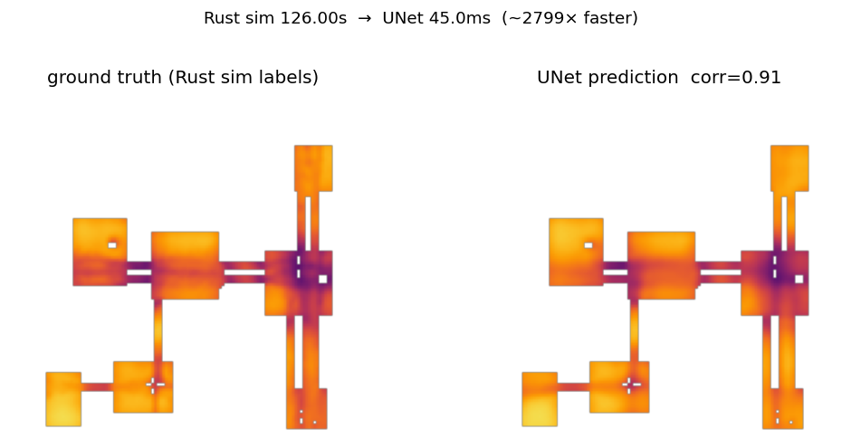

# Paraloc

Procedural indoor maps → parallel Rust ambiguity scoring → U-Net heatmap model → millisecond inference.

Given a 128×128 occupancy grid, Paraloc predicts a **localization-ambiguity heatmap**: how hard it is to localize with lidar alone at each open cell (0 = easy, 1 = highly ambiguous). The neural net approximates an expensive Monte Carlo labeler that simulates lidar scans and particle-weight entropy at every cell.

## Results

Ground-truth Rust simulation labels vs. U-Net prediction on a held-out map (`map_129`, corr ≈ 0.91). Full-map inference runs in ~35 ms on CPU vs ~126 s for the Rust labeler (~3000× faster).



---

## How the codebase fits together

```
┌─────────────────────────────────────────────────────────────────┐
│  RUST — label generation (CPU, parallel)                        │
│                                                                 │
│  gen_map ──► PNG maps                                           │
│       │                                                         │
│       ▼                                                         │
│  gen_dataset ──► for each open cell:                            │
│       │            raycaster (lidar sim)                        │
│       │            sensor_model (Gaussian scan likelihood)      │
│       │            ambiguity (entropy over particle weights)    │
│       ▼                                                         │
│  scores_grid.bin + index.json + global bins                     │
└─────────────────────────────────────────────────────────────────┘
                              │
                              ▼
┌─────────────────────────────────────────────────────────────────┐
│  PYTHON — surrogate model                                       │
│                                                                 │
│  colab_train_full.py ──► UNet128 (128×128 occupancy → heatmap)  │
│       │                                                         │
│       ▼                                                         │
│  heatmap_model_full.pt                                          │
│       │                                                         │
│       ▼                                                         │
│  infer_heatmap.py ──► prediction PNGs / comparison figures      │
└─────────────────────────────────────────────────────────────────┘
```

### Rust modules

| File | Purpose |
|------|---------|
| `src/bin/gen_map.rs` | Seeded procedural floorplan generator (rooms, corridors, doors) |
| `src/bin/gen_dataset.rs` | Batch driver: scores every open cell on every map, writes training export |
| `src/map.rs` | Load PNG occupancy grids (wall = dark, open = bright) |
| `src/raycaster.rs` | DDA lidar ray casting — simulates range scans from any pose |
| `src/sensor_model.rs` | Gaussian log-likelihood: how well a particle's scan matches the query scan |
| `src/ambiguity.rs` | Per-cell score: mean entropy of particle weights over 16 orientations |
| `src/dataset.rs` | Parallel export to `scores_grid.bin`, crops, manifests, optional preview PNGs |
| `src/config.rs` | Scoring parameters (`n_rays`, `n_score_particles`, etc.) |

### Python scripts

| File | Purpose |
|------|---------|
| `scripts/build_training_dataset.sh` | Wrapper around `gen_dataset` batch mode |
| `scripts/colab_train_full.py` | UNet128 training + validation metrics + diagnostic plots |
| `scripts/infer_heatmap.py` | Load checkpoint, predict heatmap, optional GT comparison figure |
| `scripts/requirements-train.txt` | PyTorch, numpy, Pillow, matplotlib |

### What “ambiguity” means

For each open cell `(x, y)`:

1. Simulate a 36-ray lidar scan from that cell at 16 orientations (0°, 22.5°, …).
2. Spawn 200 particles at random nearby open cells within a 10-tile radius.
3. Score each particle: how well its simulated scan matches the query scan (Gaussian sensor model).
4. Normalize weights → probability distribution → **entropy** (high = many poses look alike = hard to localize).
5. Average entropy over orientations, normalize to `[0, 1]`.

This is computed independently at every open cell on every map. That is the ground truth the U-Net learns to approximate.

---

## Full pipeline (zero to results)

### Prerequisites

- **Rust** (edition 2021) — `cargo build --release`
- **Python 3.10+** — for training and inference
- **GPU** — recommended for training (Colab T4 works); CPU inference is fine
- **Disk** — ~3 GB for the full 200-map label export
- **Time** — map gen: minutes; label gen: many hours on CPU; training: ~30–60 min on T4

---

### Step 0 — Clone and build

```bash
git clone <your-repo-url>
cd Paraloc
cargo build --release
```

Binaries land in `target/release/`:
- `gen_map` — map generator
- `gen_dataset` — label exporter

Optional scoring overrides:

```bash
cp config.toml.example config.toml
# edit score_sensor_sigma, n_score_orientations, etc.
```

---

### Step 1 — Generate maps

Each map is a 128×128 PNG: black = wall, white = open.

**Single map (sanity check):**

```bash
./target/release/gen_map --seed 42 --output map.png
```

**Full 200-map corpus:**

```bash
mkdir -p dataset_out/maps_200
for i in $(seq 1 200); do
  printf -v n "%03d" "$i"
  ./target/release/gen_map --seed "$i" --output "dataset_out/maps_200/map_${n}.png"
done
```

**Output:** `dataset_out/maps_200/map_001.png` … `map_200.png`

---

### Step 2 — Generate training labels

Scores every open cell on every map. Uses Rayon for map-level and cell-level parallelism.

**Recommended (fast export, no preview PNGs):**

```bash
./scripts/build_training_dataset.sh
```

Equivalent manual command:

```bash
cargo run --release --bin gen_dataset -- \
  --maps-dir dataset_out/maps_200 \
  --output-dir dataset_out/maps_200_train \
  --no-previews
```

**With preview PNGs** (portfolio heatmaps under each `map_XXX/`):

```bash
cargo run --release --bin gen_dataset -- \
  --maps-dir dataset_out/maps_200 \
  --output-dir dataset_out/maps_200_train
```

**Output tree:**

```
dataset_out/maps_200_train/
  index.json              # map list + stats (train/val split reads this)
  manifest.jsonl          # global per-cell index (~710k lines)
  crops.bin               # global 64×64 crops (optional archive)
  scores.bin              # global f32 scores (optional archive)
  TRAINING.txt            # binary format reference
  map_001/
    scores_grid.bin       # ★ primary U-Net label (128×128 float32 grid)
    crops.bin, scores.bin, manifest.jsonl
  map_002/
    ...
```

**`scores_grid.bin` layout:** row-major 128×128 `float32` (little-endian). Wall cells = `-1.0`. Open cells = ambiguity score in `[0, 1]`.

**Single-map test:**

```bash
cargo run --release --bin gen_dataset -- \
  --map dataset_out/maps_200/map_001.png \
  --output-dir dataset_out/maps_200_train
```

---

### Step 3 — Train the U-Net

Model: **UNet128** — 128×128 occupancy (1 channel) → 128×128 ambiguity heatmap (sigmoid output).  
Split: 180 train / 20 val maps (seed 42, from `index.json`).  
Training: 60 epochs, Adam lr=1e-3, masked MSE on open cells only.

#### Option A — Google Colab (recommended)

1. Upload to Google Drive:
   - `dataset_out/maps_200/`
   - `dataset_out/maps_200_train/`
   - `scripts/colab_train_full.py`

2. Colab: **Runtime → Change runtime type → T4 GPU**

3. Edit paths at the top of `colab_train_full.py`:

   ```python
   ROOT = Path("/content/drive/MyDrive/Paraloc")  # your folder
   ```

4. Run:

   ```python
   !pip install -q torch numpy Pillow matplotlib
   %run /content/drive/MyDrive/Paraloc/scripts/colab_train_full.py
   ```

**Output:**
- `dataset_out/heatmap_model_full.pt` — weights + training history
- `dataset_out/training_curves.png` — MSE, correlation, MAE plots
- Colab displays side-by-side GT vs prediction on 4 val maps

Download `heatmap_model_full.pt` for local inference.

#### Option B — Local GPU

```bash
python3 -m venv .venv
.venv/bin/pip install -r scripts/requirements-train.txt
```

Edit `ROOT` in `colab_train_full.py` to your local repo path, then:

```bash
.venv/bin/python scripts/colab_train_full.py
```

**Expected metrics (baseline):** val correlation ~0.92–0.93, val MAE ~0.04. MSE alone is misleading early on (scores cluster around ~0.7 mean) — watch correlation and heatmap visuals.

---

### Step 4 — Run inference

```bash
python3 -m venv .venv
.venv/bin/pip install -r scripts/requirements-train.txt
```

**Predict only:**

```bash
.venv/bin/python scripts/infer_heatmap.py \
  --checkpoint heatmap_model_full.pt \
  --map dataset_out/maps_200/map_129.png \
  --output pred_map_129.png
```

**Compare to ground truth** (same style as the README figure):

```bash
.venv/bin/python scripts/infer_heatmap.py \
  --checkpoint heatmap_model_full.pt \
  --map dataset_out/maps_200/map_129.png \
  --ground-truth dataset_out/maps_200_train/map_129/scores_grid.bin \
  --compare-out compare_map_129.png
```

**Useful flags:**
- `--device cuda` — GPU inference
- `--no-smooth` — raw pixel grid instead of display smoothing
- `--sim-seconds 126` — Rust baseline for speedup label (default)

**Output:** inferno heatmap PNG(s) + printed `corr`, inference time, and speedup vs Rust sim.

---

## Dataset format reference

| File | Used by U-Net? | Description |
|------|----------------|-------------|
| `maps_200/<map_id>.png` | **Yes** (input) | Occupancy grid |
| `maps_200_train/<map_id>/scores_grid.bin` | **Yes** (label) | Full-map ambiguity heatmap |
| `maps_200_train/index.json` | **Yes** (split) | `{ "maps": [ { "map_id": "map_001", ... }, ... ] }` |
| `crops.bin`, `scores.bin`, `manifest.jsonl` | No (archive) | Per-cell training corpus; kept for completeness |

After step 2, read `dataset_out/maps_200_train/TRAINING.txt` for byte-level layout.

---

## Repository layout

```
Paraloc/
  assets/
    compare_map_129.png          # example result (README figure)
  src/
    map.rs, raycaster.rs, ambiguity.rs, sensor_model.rs, dataset.rs
    bin/gen_map.rs, bin/gen_dataset.rs
  scripts/
    build_training_dataset.sh
    colab_train_full.py
    infer_heatmap.py
    requirements-train.txt
  config.toml.example
  Cargo.toml
```

Generated locally (gitignored): `target/`, `dataset_out/`, `*.pt`, `.venv/`

---

## License

Add your license here if open-sourcing.
